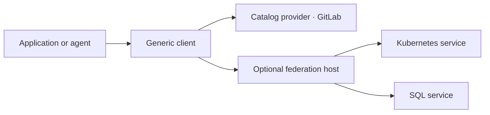

# Connectors v2

Connectors gives applications and agents a consistent way to discover and use
integrations. Each connector exposes the typed operations of one provider's API through
shared, versioned contracts; you configure an instance of it, connect it once and invoke
its operations. An application can call a connector's service directly or reach several
through an optional federation host. The words are defined once, under
[Vocabulary](#vocabulary).

**Documentation: <https://beyond10x.github.io/connectors/>**, starting at
[Getting started](https://beyond10x.github.io/connectors/docs/getting-started). The site's
source is [website/](website/README.md): concepts, guides, the CLI, crate, contract and model
reference, and the status of every capability, each held by a test.

The aim is to make an integration useful on its own and predictable when combined
with others. Provider behavior stays with its connector's implementation; shared
contracts define what callers can expect from access, results and failures.



For example, Kubernetes can report a database endpoint, while the SQL connector
provides bounded reads from an explicitly configured database. Discovering the
endpoint supplies information; selecting its connection and granting access are
separate steps.

## Vocabulary

The CLI, the configuration and the library use these words, and every page of the
documentation links here for them:

| Term | Meaning | Google | GitLab |
|---|---|---|---|
| provider | The company or technology behind one or more connectors. | Google | GitLab |
| connector | One service or app of a provider, enabled in configuration. It points at one API. | Gmail, Drive, Calendar, Slides | GitLab |
| auth profile | One way to authenticate that a connector declares. | `google.oauth` | `gitlab.pat` |
| instance | Your name for one configured connector: its endpoint, an optional description, and at most one connection. Names are free (`private`, `work`). An instance belongs to one connector and is never shared across connectors. | `gmail/private` | `gitlab/work` at a self-hosted host |
| connection | The stored credential of one instance, obtained through one auth profile. | the consent behind `gmail/private` | the token behind `gitlab/work` |
| operation | One callable tool of a connector. | `users.drafts.send` | `merge_request.merge` |

Two instances of one connector exist when you connect twice, for example with two
accounts or two hosts; the instance name addresses the right one. Every operation of
an enabled connector is available on its instances. Configuration does not group
operations or hide a subset; a library that wants a narrower surface projects one over
it. A write that requires approval still needs a proof issued for its exact input.

"Adapter" is not one of these words. It is the internal name of an implementation (the
catalog engine, a credential binary) and of the process that serves an instance.

The typed model of providers, connectors and their instances, with its cardinalities, is
the generated
[declarations model](https://beyond10x.github.io/connectors/docs/reference/contracts/model/domains/connectors-declarations);
connections and their states are in the
[auth bindings model](https://beyond10x.github.io/connectors/docs/reference/contracts/model/domains/connectors-auth_bindings).

### Configure instances

A `connectors-local/5` configuration enables connectors by name and names their instances.
`setup init` creates the file, in that format with an empty legacy `[adapters]` table, and the
metadata store; `setup migrate --apply` moves an older file without legacy entries to it. Add
your instances to that file, or replace its content with yours, keeping `owner_uid` (your user
id):

```toml
format = "connectors-local/5"
owner_uid = 1000
default_instance = "gitlab/work"

[connectors.gmail]
enabled = true

[connectors.gmail.instances.private]
description = "personal mailbox"

[connectors.gitlab]
enabled = true

[connectors.gitlab.instances.work]
endpoint = "https://gitlab.example.com"
```

An instance without `endpoint` uses its connector's default (`https://gmail.googleapis.com` for
Gmail); a GitLab endpoint is the host, `https://<host>` (a trailing `/` allowed), or
`https://<host>/<path>` for a relative root, never a URL that already ends in `/api/v4`. An instance names only what is yours: its endpoint, an
optional description and, where its connector declares more than one auth profile (Zendesk),
`profile`. Everything else comes from the connector shipped with the `connectors-catalog-provider`
installed beside `connectors`: the executable and its SHA-256, the configuration revision and
every operation. `default_instance` selects an instance for a command that names none.

```sh
connectors --config "$PWD/cli/config.toml" --state-dir "$PWD/cli/state" instances list \
  | jq -c '.[] | arrays | .[]'
```

```json
{"connector":"gitlab","instance":"work","instance_id":"gitlab.work","restart":"never","startup":"on-demand"}
{"connector":"gmail","instance":"private","instance_id":"gmail.private","restart":"never","startup":"on-demand"}
```

Each item names its instance by `connector` and `instance`. A legacy catalog entry for which no
connector is derived is left out of the items and named in an `unmigrated` list instead; see
[Move a legacy configuration](#move-a-legacy-configuration).

`connections connect <connector>/<instance> --endpoint <url>` adds an instance with that endpoint,
and the connector's table when it is missing, before it asks for the credential; every other
byte of the file stays as it was. A different endpoint on an existing instance is refused and
writes nothing.

### Select an instance

`invoke` names its instance as `<connector>/<instance>`, then the operation, and reads the input
from standard input when no input flag is given:

```sh
printf '{"id":"group/project","merge_request_iid":9}' \
  | connectors --config "$PWD/cli/config.toml" --state-dir "$PWD/cli/state" \
    invoke gitlab/work merge_request.get
```

The instance may be left out while its connector has one. With a second GitLab instance `oss`
in the file, `invoke gitlab merge_request.get` is refused, exit status 2, naming both:

```text
failure: {"code":"instance_ambiguous","instances":["gitlab/oss","gitlab/work"],"kind":"usage","next_action":"none","stage":"arguments"}
```

`invoke` does not read `default_instance`. The connection, schema and revision default to the
instance's own, and `invoke <connector>/<instance> <operation> --describe` prints the operation's
input schema, effect, schema and revision without calling the provider. Other commands that act
on one instance take `--connector` and `--instance`; an instance name is unique within its
connector only:

```sh
connectors --config "$PWD/cli/config.toml" --state-dir "$PWD/cli/state" \
  connections list --connector gitlab --instance work
```

```json
{"connections":[],"observed_at_ms":1793314944444,"source":"authority","stale":false,"valid_until_ms":1793315244444}
```

The deprecated `--adapter <alias>` still selects the same instance (`--adapter gitlab.work`) and
says so once, on standard error, or as a `deprecations` member of the JSON envelope:

```text
deprecated: --adapter; select with --connector <connector> --instance <instance>
```

`instances list`, `describe`, `status` and `stop` replace the deprecated `adapters` group, and
`connections reconnect` replaces the deprecated `connections repair`; each old name runs the same
command and says it is deprecated the same way. The
[CLI reference](https://beyond10x.github.io/connectors/docs/reference/cli) lists every command.

### Connections: Live, Stale, Revoked

An instance holds at most one connection. `connections connect` on an instance that already
holds a Live or Stale connection is refused before it asks for a credential, naming what helps
instead; connect a second account as a second instance.

| From | To | When |
|---|---|---|
| Live | Stale | the provider refused the stored credential: an expired or revoked refresh token, a changed password, a revoked token |
| Stale | Live | `connections reconnect` published a new credential for the same instance and connection |
| Live, Stale | Revoked | `connections revoke` ended local use |

Refreshing an OAuth access token is not a state change; only a refused refresh token makes a
connection Stale, and no retry can renew it. An invoke on a Stale connection answers with the
next action `repair_connection`, which names `connections reconnect`.
`connections describe`, `reconnect`, `revalidate`, `launch`, `token` and `revoke` take the
instance's one connection when `--connection` is left out.

### Get an access token

`connections token` issues a current access token of an OAuth2 grant connection. While the
stored token stays valid for longer than the profile's refresh lead it is issued as it is;
otherwise the owner refreshes it once first. Without `--reveal` it prints only what was
issued; the output below is from the loopback test authorization server:

```sh
connectors connections token --connector <connector> --instance <instance>
```

```json
{"connection":"conn_5a032a7ae1bb4576913176e9a9c63403_5872010755134cfeb5a9da9139d99d4f","expires_at":"2026-10-26T04:59:26.453Z","issue":"4d6ad0f2-61d1-4499-95b2-362798145833","refreshed":false,"scopes":["fixture.read","fixture.profile"]}
```

With `--reveal`, standard output is the token and one newline, for a pipe:

```console
$ connectors connections token --connector <connector> --instance <instance> --reveal
fixture-grant-access-1
```

Every issue is recorded, with its delivery but never the token. A Stale connection, and a
refresh the provider refuses, answer `repair_connection`; a profile that is not an OAuth2
grant is `forbidden`. Programs in Rust call `connectors_host::local::access_token::access_token`
instead, whose value prints no token in `Debug` or `Display`.

### Move a legacy configuration

A legacy `[adapters.<alias>]` entry keeps working until it is moved. A catalog entry is named by
the connector `setup migrate` derives for it and its alias (`gitlab/forge` below); any other entry
by its `adapter_id` and its alias. A catalog entry no connector is derived for, such as a
legacy-format OpenRouter entry, is no instance: `instances list` names it in
`unmigrated`, and selecting it is `invalid_configuration` with the rule
`legacy_entry_unmigrated`. Its replacement is a `[connectors.<connector>]` instance.
`setup migrate` moves each catalog entry whose provider
ships a connector to `[connectors.<connector>.instances.<alias>]`, keeping its instance id,
configuration revision, executable and custody item names byte for byte, so its connections and
approval policy stay valid with no new consent. Other entries stay where they are, each with its
reason. `--dry-run` writes nothing; on a file with one legacy GitLab entry `forge`:

```sh
connectors --config "$PWD/config.toml" --state-dir "$PWD/state" --output json \
  setup migrate --dry-run \
  | jq -c '.result | {disposition, format_before, format_after}, (.entries[] | {connector, instance, disposition})'
```

```json
{"disposition":"planned","format_before":"connectors-local/2","format_after":"connectors-local/5"}
{"connector":"gitlab","instance":"forge","disposition":"migrated"}
```

`--apply` keeps the file it read beside the new one:

```sh
connectors --config "$PWD/config.toml" --state-dir "$PWD/state" --output json \
  setup migrate --apply | jq -r '.result.disposition, (.result.backup_path | split("/") | last)'
```

```text
applied
config.toml.before-migrate-20261016T201716Z
```

The moved instance is then selected as `--connector gitlab --instance forge`. Rolling back is
restoring the backup. The [CLI contract on legacy entries](contracts/cli/v1alpha1/semantics.md#migrating-adapter-entries)
lists every reason an entry is kept.

## Where the project stands

These connectors run today; each one's page lists its operations. The [changelog](CHANGELOG.md)
records each release's scope and remaining work; the [status page](https://beyond10x.github.io/connectors/docs/status) lists each capability with its test.

| Connector | Implemented operations | Binding | Private protocol (connectors-private/N) |
|---|---|---|---|
| [GitLab](https://beyond10x.github.io/connectors/docs/connectors/gitlab/) (catalog provider) | [53](https://beyond10x.github.io/connectors/docs/connectors/gitlab/) | GitLab API v4 from the pinned OpenAPI source; the full summary is in [the GitLab guide](docs/local-gitlab-merge.md) | 1-3 |
| [Gmail](https://beyond10x.github.io/connectors/docs/connectors/gmail/) (catalog provider) | [10](https://beyond10x.github.io/connectors/docs/connectors/gmail/) | Gmail API v1 from the pinned Discovery document projected to OpenAPI; profile `google.oauth` (`oauth2_refresh`), one instance per Google account consenting to `gmail.readonly` and `gmail.compose`; the full summary is in [the Gmail guide](docs/catalog-google-gmail.md) | 1-3 |
| [Google Drive](https://beyond10x.github.io/connectors/docs/connectors/drive/) (catalog provider) | [9](https://beyond10x.github.io/connectors/docs/connectors/drive/) | Drive API v3 from the pinned Discovery document projected to OpenAPI; profile `google.oauth`, one instance per Google account consenting to `drive.readonly` and `drive.file`; the full summary is in [the Drive guide](docs/catalog-google-drive.md) | 1-3 |
| [Google Calendar](https://beyond10x.github.io/connectors/docs/connectors/calendar/) (catalog provider) | [6](https://beyond10x.github.io/connectors/docs/connectors/calendar/) | Calendar API v3 from the pinned Discovery document projected to OpenAPI; profile `google.oauth`, one instance per Google account consenting to `calendar.readonly` and `calendar.events`; the full summary is in [the Calendar guide](docs/catalog-google-calendar.md) | 1-3 |
| [Google Slides](https://beyond10x.github.io/connectors/docs/connectors/slides/) (catalog provider) | [5](https://beyond10x.github.io/connectors/docs/connectors/slides/) | Slides API v1 from the pinned Discovery document projected to OpenAPI; profile `google.oauth`, one instance per Google account consenting to `presentations` and `presentations.readonly`; the full summary is in [the Slides guide](docs/catalog-google-slides.md) | 1-3 |
| [Jira](https://beyond10x.github.io/connectors/docs/connectors/jira/) (catalog provider) | [17](https://beyond10x.github.io/connectors/docs/connectors/jira/) | Jira Cloud platform REST v3 from the pinned OpenAPI document; profile `atlassian.basic` (account email and API token as HTTP basic), shared with Confluence; the full summary is in [the Jira guide](docs/catalog-jira.md) | 1-3 |
| [Confluence](https://beyond10x.github.io/connectors/docs/connectors/confluence/) (catalog provider) | [11](https://beyond10x.github.io/connectors/docs/connectors/confluence/): 4 under `confluence` (REST v2), 7 under `confluence-v1` (REST v1) | Confluence Cloud REST v2 from the pinned OpenAPI document, and REST v1 from a document this repository writes from Atlassian's reference pages; profile `atlassian.basic`, shared with Jira; the full summary is in [the Confluence guide](docs/catalog-confluence.md) | 1-3 |
| [Zendesk](https://beyond10x.github.io/connectors/docs/connectors/zendesk/) (catalog provider) | [10](https://beyond10x.github.io/connectors/docs/connectors/zendesk/) | Zendesk Support API from the pinned OpenAPI document; two profiles, `zendesk.oauth` (OAuth client credentials) and `zendesk.basic` (API token), chosen per instance by `profile`; the full summary is in [the Zendesk guide](docs/catalog-zendesk.md) | 1-3 |
| [HubSpot](https://beyond10x.github.io/connectors/docs/connectors/hubspot/) (catalog provider) | [4](https://beyond10x.github.io/connectors/docs/connectors/hubspot/) | HubSpot CRM Objects `2026-09` and Owners `2026-09` from the pinned OpenAPI documents; private-app token as `Authorization: Bearer` from keyring custody, profile `hubspot.private-app`; reads only, any object type and the account's owners, no time filter; verified against a local fixture only, see [the HubSpot guide](docs/catalog-hubspot.md) | 1-3 |
| [Slack](https://beyond10x.github.io/connectors/docs/connectors/slack/) (catalog provider) | [22](https://beyond10x.github.io/connectors/docs/connectors/slack/): 17 on the bot-token instance, 5 on a second instance with a user token | Slack Web API from the pinned Swagger 2.0 document projected to OpenAPI; the full summary is in [the Slack guide](docs/catalog-slack.md) | 1-3 |
| [Opsgenie](https://beyond10x.github.io/connectors/docs/connectors/opsgenie/) (catalog provider) | [5](https://beyond10x.github.io/connectors/docs/connectors/opsgenie/) | Opsgenie REST API from the pinned Swagger 2.0 document; the full summary is in [the Opsgenie guide](docs/catalog-opsgenie.md) | 1-3 |
| [Runpod](https://beyond10x.github.io/connectors/docs/connectors/runpod/) (catalog provider) | [4](https://beyond10x.github.io/connectors/docs/connectors/runpod/) | Runpod REST API v1 from the pinned OpenAPI source; the full summary is in [the Runpod guide](docs/catalog-runpod.md) | 1-3 |
| [OpenRouter](https://beyond10x.github.io/connectors/docs/connectors/openrouter/) (catalog provider) | [4](https://beyond10x.github.io/connectors/docs/connectors/openrouter/) | OpenRouter API from the pinned OpenAPI document; management key as `Authorization: Bearer` from keyring custody, profile `openrouter.api-key`; the full summary is in [the OpenRouter guide](docs/catalog-openrouter.md) | 1-3 |
| [Grafana](https://beyond10x.github.io/connectors/docs/connectors/grafana/) (catalog provider) | [8](https://beyond10x.github.io/connectors/docs/connectors/grafana/) | Grafana HTTP API from the pinned OpenAPI 3 document; the full summary is in [the catalog Grafana guide](docs/catalog-grafana.md) | 1-3 |
| [ChatGPT](https://beyond10x.github.io/connectors/docs/connectors/chatgpt/) (catalog provider) | [1](https://beyond10x.github.io/connectors/docs/connectors/chatgpt/) | ChatGPT subscription sign-in as the Codex CLI makes it, profile `chatgpt.subscription` (`oauth2_grant`): browser with PKCE on `127.0.0.1:1455`, or `--device` through the ChatGPT device sign-in; the full summary is in [the ChatGPT guide](docs/local-catalog-provider.md) | 1-3 |
| [Claude subscription](https://beyond10x.github.io/connectors/docs/connectors/claude-subscription/) (catalog provider) | [1](https://beyond10x.github.io/connectors/docs/connectors/claude-subscription/) | The Claude Code sign-in (OAuth 2.0 authorization code with PKCE, JSON exchange and refresh) for the operator's own Claude plan only, as the guide's quote of the provider's terms says; the full summary is in [the Claude subscription guide](docs/local-catalog-provider.md) | 1-3 |
| [GitHub](https://beyond10x.github.io/connectors/docs/connectors/github/) (catalog provider) | [10](https://beyond10x.github.io/connectors/docs/connectors/github/) | GitHub REST API from `connectors/github.yaml` of [connectors-definitions 0.5.2](https://github.com/beyond10x/connectors-definitions/releases/tag/0.5.2), run as a definition file (`invoke --definition`); the full summary is in [the GitHub guide](docs/local-catalog-provider.md) | 1-3 |
| [Kubernetes](https://beyond10x.github.io/connectors/docs/connectors/kubernetes/) | [15](https://beyond10x.github.io/connectors/docs/connectors/kubernetes/), 10 of them when switched on in the native file | Kubernetes API, with namespace and resource-kind restrictions (`pods`, `services`, `deployments`, `endpointslices`, `replicasets`, `statefulsets`, `events`); the full summary is in [the Kubernetes guide](docs/local-kubernetes-cli.md) | 1-2 (2 with `pod_exec`) |
| SQL ([PostgreSQL](https://beyond10x.github.io/connectors/docs/connectors/postgres/), [MySQL](https://beyond10x.github.io/connectors/docs/connectors/mysql/)) | 7 | PostgreSQL or MySQL, chosen per connection by `engine` (default PostgreSQL), with read-only transactions or sessions and execution deadlines; `profile.read` runs a read profile the native file names; saved password through the local CLI; see [the PostgreSQL guide](docs/local-postgres-cli.md) and [the MySQL guide](docs/local-mysql-cli.md) | 1 |
| [Tavily](https://beyond10x.github.io/connectors/docs/connectors/tavily/) | [3](https://beyond10x.github.io/connectors/docs/connectors/tavily/) | Tavily API from the pinned OpenAPI source, profile `tavily/2026-10`; API key from keyring custody, checked with `GET /usage`; every operation is a read Tavily serves as a POST; see [the Tavily guide](docs/local-tavily.md) | 1 |
| [Loki](https://beyond10x.github.io/connectors/docs/connectors/loki/) | [5](https://beyond10x.github.io/connectors/docs/connectors/loki/) | Loki HTTP API, one GET each; bearer token from keyring custody, proved with `GET /loki/api/v1/labels`; `logs.profile_lines` and `logs.call_trace` run line and trace profiles the native file names; no tenant header is sent; see [the Loki guide](adapters/loki/README.md) | 1 |
| [Grafana](https://beyond10x.github.io/connectors/docs/connectors/grafana/) | [5](https://beyond10x.github.io/connectors/docs/connectors/grafana/): 1, and 4 IRM reads on a second instance | Grafana HTTP API, one `GET /api/datasources`; the full summary is in [the Grafana guide](adapters/grafana/README.md) | 1 |
| [Prometheus](https://beyond10x.github.io/connectors/docs/connectors/prometheus/) | [3](https://beyond10x.github.io/connectors/docs/connectors/prometheus/) | Prometheus HTTP API, one GET each; the full summary is in [the Prometheus guide](adapters/prometheus/README.md) | 1 |

Credentials stay in the platform's store, fixed when the binary is built
([§5.1](contracts/auth/custody/v1alpha1/semantics.md#51-platform-bindings-of-the-local-host)): on
Linux the Secret Service, or the read-only `mounted_secret` binding a `[custody]` table selects
for a container with no keyring, which refuses OAuth refresh and approval signing
([§5.2](contracts/auth/custody/v1alpha1/semantics.md#52-the-read-only-mounted-secret-binding),
[guide](docs/local-mounted-secret-custody.md)); on macOS the login keychain; on Windows the
Credential Manager. Kubernetes and SQL also run as separate Rust services, which advertise no
writes; writes run only through the local CLI under approval. On Linux,
`connectors server --transport stdio` is a local MCP server that offers admitted read-only
operations as tools through the same owner and custody ([guide](docs/local-mcp-stdio.md)); it
offers no resources, prompts, writes or outbound MCP, and on macOS and Windows it exits with
`mcp_unavailable`. A headless Claude Code session listed a Jira instance's reads through it and called its
search tool; the recorded entries, `claude mcp add` output and replay test are in the
[guide](docs/local-mcp-stdio.md#recorded-claude-code-session). Reading
from an MCP server as a connector is not implemented; the two decision blockers on its
contracts are cleared ([MCP](https://beyond10x.github.io/connectors/docs/connectors/mcp/)).

## Get started

Build the workspace from the repository root with Rust 1.91.0 or later. The
independent libraries are also checked on Rust 1.88.0:

```sh
cargo build --workspace --locked
```

Ordinary builds use checked-in generated Rust. They do not require ESS or refresh
vendor specifications; Cargo may need to download dependencies on the first build.

Or install a release binary: each release page carries `connectors-<version>-<target>.tar.gz`
for Linux and macOS, whose directory holds `connectors` and `connectors-catalog-provider`
([Getting started](https://beyond10x.github.io/connectors/docs/getting-started#or-install-a-release-binary)).
Keep the two binaries in one directory: an instance that pins nothing is derived by the provider
beside `connectors`, which `setup check` lists as the `installed_provider` prerequisite. The macOS
binaries are not signed. An archive downloaded through a browser carries Gatekeeper's quarantine
attribute, and its binaries are refused until you remove it from the extracted directory:

```sh
xattr -dr com.apple.quarantine "connectors-$version-$target"
```

Or run the container image: releases from 0.70.0 on publish `ghcr.io/beyond10x/connectors:<version>`
for `linux/amd64` and `linux/arm64`, with the Linux archive's binaries, running as a non-root user
and starting `connectors-catalog-provider` ([In a container](docs/running-services.md#in-a-container)).

To use the local CLI, configure an instance as [Vocabulary](#vocabulary) shows and follow the
[Getting started](https://beyond10x.github.io/connectors/docs/getting-started) page and the
guide of its connector. To run a connector as a standalone service instead, choose a service
configuration from [examples](examples/), set its permitted resources and private credential
references, then follow [Run connector services](docs/running-services.md). For an end-to-end local
exercise with disposable Kubernetes and PostgreSQL services, use the
[live acceptance recipe](docs/live-e2e.md).

The [development guide](docs/development.md) covers the full gate, pinned
generation tools and embedding the internal adapter libraries.

## Explore the design

- [Vision](VISION.md): who this serves, the intended system and how we will judge success.
- [Contracts](contracts/README.md): shared guarantees, versions and support status.
- [Implementations](adapters/README.md): native contracts, provider ownership and extraction boundaries.
- [Connector vocabulary](docs/design/connector-vocabulary.md): why the terms above replaced the
  old ones, and what changed with them.
- [Architecture and design](docs/design.md): decisions, rationale and implementation boundaries.
- [Documentation website](website/README.md): concepts, guides, generated CLI, crate, contract and
  model reference, status and executable examples; [design and boundaries](docs/website-design.md).

Run the local website with `npm ci --allow-git=root` and `npm start` from `website/` after its
[toolchain setup](website/README.md#start-the-preview). The preview is served at
http://127.0.0.1:3100/connectors/. The `Documentation validation` workflow builds the site on
every pull request and push, and `Documentation site` deploys a build of `main` to
<https://beyond10x.github.io/connectors/>. Follow an illustrated GitLab
request walkthrough or inspect the advanced contract exercises. Both use fictional
Rust/WASM behavior, separately from the connector runtime; specified user authorization
is labeled separately from configured federation available today.

Agents making repository changes should start with [AGENTS.md](AGENTS.md).

## Licence

MIT OR Apache-2.0, as `Cargo.toml` declares.
