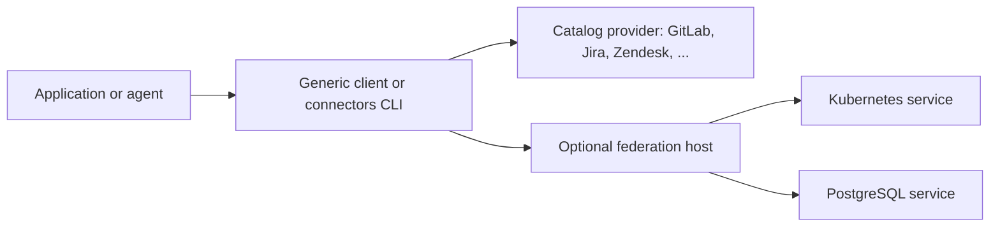

# Connectors

Connectors gives applications and agents one way to discover and use integrations. A connector
exposes the typed operations of one provider's API through shared, versioned contracts. You
configure an instance of it, connect that instance once, and invoke its operations; a caller can
also reach a connector's service directly or several through an optional federation host.

The words provider, connector, auth profile, instance, connection and operation are defined once,
in the [repository README](https://github.com/beyond10x/connectors#vocabulary); this site uses
them in that sense.

Three ideas carry the rest of this documentation:

- **Contracts describe guarantees.** Inputs and outputs are part of a contract, and so are access,
  lifecycle, partial results, retries and failures. See [Contracts and guarantees](./concepts/contracts.md).
- **Each connector keeps its provider's meaning.** Kubernetes selectors and PostgreSQL query rules
  belong to their connector's implementation; shared contracts stay independent of every
  provider.
  [Adapters and ownership](./concepts/adapters.md) describes these internal implementations.
- **Composition connects explicit boundaries.** Discovering a database endpoint does not create a
  connection or grant access. A host binds its target, credential and authority deliberately.

## What runs today

Every release is a source release with `connectors` binaries for Linux and macOS. The
[status page](./status.md) lists each capability with the test that holds it. In short:

- The **catalog provider** serves GitLab, Jira Cloud, Confluence Cloud, HubSpot CRM, Zendesk
  Support, Google Drive, Slides, Calendar and Gmail, Opsgenie, Slack and Runpod from their pinned
  API documents, with no Rust per endpoint ([catalog provider](./concepts/catalog-provider.md)).
- **Native connectors** run Kubernetes resource reads and discovery, PostgreSQL and MySQL reads,
  Tavily web search, Loki LogQL reads and Grafana data-source records
  ([connector reference](./reference/adapters/index.md)).
- The **local `connectors` CLI** keeps connection metadata in Entity Runtime over an Eventlog SQLite
  store and credentials in the platform's keyring, starts the process that serves each configured
  instance and runs approved writes ([local runtime](./concepts/local-runtime.md)).
- **Standalone services** answer `describe` and `invoke` over HTTP, alone or behind one federation
  host ([getting started](./getting-started.md)); see
  [federate services](./guides/federate-adapter-services.md) for a host in front of an internal service.

## What it is not

- Not a hosted service. Nothing here deploys anything; release pages carry Linux and macOS
  binaries of the `connectors` command, and package distribution is not configured.
- Not a credential vault. Custody is the platform's keyring; a credential never travels in
  operation input, and the federation host never holds a provider credential.
- Not a retry layer. No host retries a provider request on its own; an uncertain write stays
  uncertain and is never sent twice.
- Not an agent runtime or an MCP server. MCP contracts are specified, and no MCP runtime exists.
- Not a list of every API it could call. A contract or a specified connector is not an installed
  capability; the [status page](./status.md) separates the two.

## Neighbours

- [ESS](https://beyond10x.github.io/ess/) ([GitHub](https://github.com/beyond10x/ess)) specifies
  Connectors: the shared model, the native models of each connector and the CLI binding the
  `connectors` parser is generated from.
- [Entity Runtime](https://beyond10x.github.io/ecosystem/entity-runtime/)
  ([GitHub](https://github.com/beyond10x/entity-runtime)) holds the local CLI's connection
  metadata, approvals and audit as recorded entity state.
- [Eventlog](https://beyond10x.github.io/ecosystem/eventlog/)
  ([GitHub](https://github.com/beyond10x/eventlog)) stores that state: Entity Runtime runs on its
  SQLite provider.

## Where to go next

| You want to | Read |
|---|---|
| Build it and see a service answer | [Getting started](./getting-started.md) |
| Configure an instance for the local CLI | [Set up the local CLI](./guides/set-up-the-local-cli.md) |
| Understand the guarantees | [Contracts and guarantees](./concepts/contracts.md) |
| Follow one request end to end | [Follow a request to GitLab](./examples/follow-a-request.mdx) |
| Look up a command | [connectors CLI](./reference/cli.md) |
| Read a contract exactly | [Contract reference](./reference/contracts/index.md) |
