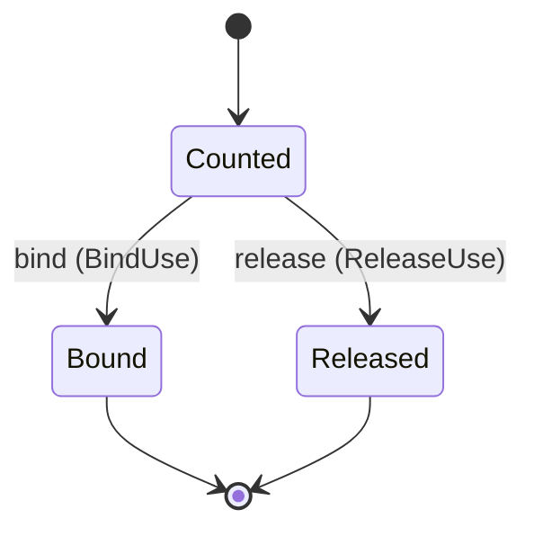

---
# generated by connectors-docs, do not edit
title: "standing_approvals"
sidebar_label: "standing_approvals"
sidebar_position: 25
description: "Standing write grants an operator mounts for a served instance, and the hourly count of writes admitted under each."
custom_edit_url: null
---

# standing_approvals

:::info[Typed specification]

Generated by the pinned `ess generate --kind docs` from [`ess`](https://github.com/beyond10x/connectors/tree/main/ess). Structural validation establishes consistency; behaviour, storage and cross-record predicates remain implementation obligations.

:::

Standing write grants an operator mounts for a served instance, and the hourly count of writes admitted under each.

`connectors.standing_approvals` is one of connectors's bounded contexts. [Back to the index](../index.md).

## Types

### `GrantFile`

`connectors.standing_approvals.GrantFile` is a record of three fields:

- `format` — `String`
- `grants` — `List<connectors.standing_approvals.StandingGrant>`
- `revoked` — `List<String>`

Every value satisfies `format == "connectors.standing-grants/1"`.

### `StandingGrant`

`connectors.standing_approvals.StandingGrant` is a record of six fields:

- `id` — `String`
- `instance` — `String`
- `operation` — `String`
- `target` — `List<connectors.standing_approvals.TargetMember>`
- `not_after_unix_ms` — `Integer`
- `max_per_hour` — `Integer`

Every value satisfies `(not_after_unix_ms >= 0 and not_after_unix_ms <= 9007199254740991)` and `(max_per_hour >= 1 and max_per_hour <= 10000)`.

### `TargetMember`

`connectors.standing_approvals.TargetMember` is a record of two fields:

- `pointer` — `String`
- `value` — `Json`

One of the types above is reached by nothing else in this system: `connectors.standing_approvals.GrantFile`. No entity, view, command, event, error or crossing names it, so it is either vocabulary something outside this specification uses or a leftover — and only a person can tell which.

## Entities

An entity is what this context is about: something with an identity that outlives any one request, a shape, and a lifecycle. The lifecycle is exhaustive — a move that is not drawn below is a move this specification does not permit, and that is the only way it says so. Every move is labelled with the command that takes it, because a move nothing can trigger is refused rather than drawn.

### `GrantUse`

`connectors.standing_approvals.GrantUse`.

An instance is identified by `use_id`, a `Uuid`. The name is part of the model and not a convention: a view projects the identity under that name, so a projection inventing its own would disagree with the view.

It holds:

- `grant_id` — `String`
- `instance_id` — `String`
- `admitted_at_unix_ms` — `Integer`
- `attempt_id` — `Optional<connectors.mutations.AttemptId>`, which may be absent

It references at most one [`connectors.declarations.ServiceConfiguration`](./connectors-declarations.md#serviceconfiguration), as `instance`, carried by `GrantUse.instance_id`. It references at most one [`connectors.mutations.AttemptRecord`](./connectors-mutations.md#attemptrecord), as `attempt`, carried by `GrantUse.attempt_id`.

Every instance satisfies `(admitted_at_unix_ms >= 0 and admitted_at_unix_ms <= 9007199254740991)` — a predicate over this entity's own fields, checked against them rather than stored as a sentence, so an invariant reading something the entity does not have is refused instead of documented.

Its state is a `connectors.standing_approvals.GrantUse.State`, one of `Bound`, `Counted` and `Released`. That enum is synthesised from the lifecycle rather than declared beside it, so the states a view's filter compares and the states drawn below cannot disagree.

An instance is created in `Counted`. `Bound` and `Released` are terminal, so an instance may rest there forever. That is declared rather than inferred from having no way out: an entity that cannot leave a state is either finished or stuck, and only its author knows which.

Each move is taken by a declared command outcome, and a move nothing takes is refused as `missing_causation` rather than left as a state change nobody can trigger:

- `bind` — taken by `connectors.standing_approvals.BindUse` on its `bound` outcome
- `release` — taken by `connectors.standing_approvals.ReleaseUse` on its `released` outcome

An instance is brought into existence by `connectors.standing_approvals.CountUse` on its `counted` outcome.

Illegal transitions are illegal by absence: no rule forbids them, there is simply no arrow, because a rule would be a second place for the same truth to live. A diagram cannot show an absence, so the pairs it does not connect are listed here, derived from the same transitions — anything named below is a move this specification does not permit.

- `Bound` may not become `Counted`
- `Bound` may not become `Released`
- `Released` may not become `Bound`
- `Released` may not become `Counted`

One view projects it: [`GrantUses`](#grantuses).

## Views

A view is what the outside world is promised it can observe. Each one says which instances it contains and how soon it reflects a command that has already returned, because "you can read this" without "how soon" is the promise every flaky suite is built on.

### `GrantUses`

`connectors.standing_approvals.GrantUses`.

It reads [`GrantUse`](#grantuse).

It contains every instance of that entity: no filter narrows it, which is a decision somebody made and not a line somebody omitted.

It exposes:

- `use_id` — `Uuid`
- `grant_id` — `String`
- `instance_id` — `String`
- `admitted_at_unix_ms` — `Integer`
- `attempt_id` — `Optional<connectors.mutations.AttemptId>`, which may be absent
- `state` — `connectors.standing_approvals.GrantUse.State`

It declares no order, so the rows come back in whatever order the implementation has, and two reads may disagree.

**Read-your-writes**: it is current the moment the command that changed it returns. A caller that has just created an invoice and cannot see it in here has been told a lie about what it did.

A generated scenario asserts it once, immediately after the command: a view promising this and not keeping the promise has to fail the suite rather than be retried until it passes.

## Commands

### `BindUse`

`connectors.standing_approvals.BindUse`.

It takes:

- `use_id` — `Uuid`
- `attempt_id` — `connectors.mutations.AttemptId`

It has two outcomes.

**`bound`** — The default branch, taken when no other outcome's condition matched. It moves a `connectors.standing_approvals.GrantUse` from `Counted` to `Bound`, along the declared move `bind`. The instance is the one named by the input field `use_id`. It emits `connectors.standing_approvals.UseBound`. It sets `attempt_id` from `input.attempt_id`. A test reaches it by constructing an input that satisfies no other outcome's condition.

**`conflict`** — Taken when the subject is resting in a state none of this command's moves start from — a `connectors.standing_approvals.GrantUse` in `Bound` and `Released`, which is what is left of the lifecycle once this command's own moves are taken away. The document lists none of it. No entity in this specification changes. It reports `connectors.standing_approvals.UseStateConflict`, carrying `state`. It emits nothing. A test reaches it by driving an instance into one of those states and then issuing the command, because no input selects this branch.

### `CountUse`

`connectors.standing_approvals.CountUse`.

It takes:

- `use_id` — `Uuid`
- `grant_id` — `String`
- `instance_id` — `String`
- `admitted_at_unix_ms` — `Integer`

It has one outcome.

**`counted`** — The default branch, taken when no other outcome's condition matched. It creates a `connectors.standing_approvals.GrantUse`, which starts in `Counted`. The new instance's identity is published as `use_id` on `connectors.standing_approvals.UseCounted`. It emits `connectors.standing_approvals.UseCounted`. It sets `grant_id` from `input.grant_id`, `instance_id` from `input.instance_id` and `admitted_at_unix_ms` from `input.admitted_at_unix_ms`. A test reaches it by constructing an input that satisfies no other outcome's condition.

### `ReleaseUse`

`connectors.standing_approvals.ReleaseUse`.

It takes:

- `use_id` — `Uuid`

It has two outcomes.

**`released`** — The default branch, taken when no other outcome's condition matched. It moves a `connectors.standing_approvals.GrantUse` from `Counted` to `Released`, along the declared move `release`. The instance is the one named by the input field `use_id`. It emits `connectors.standing_approvals.UseReleased`. A test reaches it by constructing an input that satisfies no other outcome's condition.

**`conflict`** — Taken when the subject is resting in a state none of this command's moves start from — a `connectors.standing_approvals.GrantUse` in `Bound` and `Released`, which is what is left of the lifecycle once this command's own moves are taken away. The document lists none of it. No entity in this specification changes. It reports `connectors.standing_approvals.UseStateConflict`, carrying `state`. It emits nothing. A test reaches it by driving an instance into one of those states and then issuing the command, because no input selects this branch.

## Events

### `UseBound`

`connectors.standing_approvals.UseBound`.

It carries:

- `use_id` — `Uuid`
- `attempt_id` — `connectors.mutations.AttemptId`

Emitted by `connectors.standing_approvals.BindUse` on its `bound` outcome.

Nothing in this system reacts to it.

### `UseCounted`

`connectors.standing_approvals.UseCounted`.

It carries:

- `use_id` — `Uuid`

Emitted by `connectors.standing_approvals.CountUse` on its `counted` outcome.

Nothing in this system reacts to it.

### `UseReleased`

`connectors.standing_approvals.UseReleased`.

It carries:

- `use_id` — `Uuid`

Emitted by `connectors.standing_approvals.ReleaseUse` on its `released` outcome.

Nothing in this system reacts to it.

## Errors

### `UseStateConflict`

It carries:

- `state` — `connectors.standing_approvals.GrantUse.State`

Reported by `connectors.standing_approvals.BindUse` on its `conflict` outcome.

Reported by `connectors.standing_approvals.ReleaseUse` on its `conflict` outcome.

## Actors

An actor is who may ask this context for something. Every grant below points at a command this specification declares — a grant is a resolved reference, so "may invoke" something nobody wrote is not a permission this model can express, and an authorisation that authorises nothing cannot ship quietly.

### `ServiceHost`

`connectors.standing_approvals.ServiceHost`.

It may invoke [`BindUse`](#binduse), [`CountUse`](#countuse) and [`ReleaseUse`](#releaseuse).

---

Generated from connectors v1 · model digest `b3c4035f7508a85723ca680862d5a5dcc698e0664ff00f782d3b3714e08a468b` · contract digest `slice-sha256/2:3db418641f2b63174f528d2afcd32c778a6088f7ca22c0bb1db7233fb5a88688`. Do not edit this file; change the specification and regenerate it with `ess generate`.
